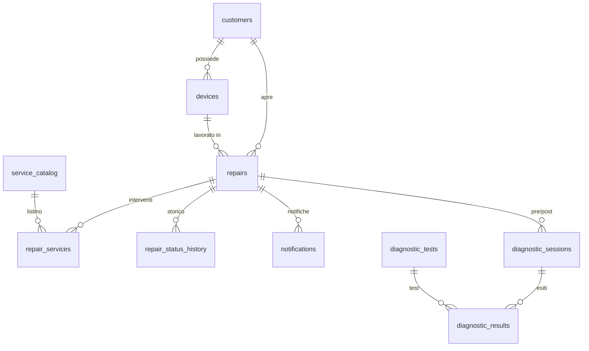

# DanfixMate — Architettura

## 1. Stack e motivazioni

| Livello | Scelta | Perché |
|---|---|---|
| Shell desktop | **Electron 45** | Node completo nel main process: `child_process` per adb/scrcpy/libimobiledevice senza ponti nativi; ecosistema maturo su Windows. Tauri richiederebbe Rust + sidecar per ogni binario, con poco guadagno per un'app da banco. |
| Build | **electron-vite** | Un solo config per main / preload / renderer, HMR sul renderer. |
| UI | **React 19 + TypeScript + Tailwind 4 + lucide-react** | Tema scuro in token (`@theme`), font di sistema (funziona offline). |
| Stato UI | **zustand** | Store minimi (dispositivi live, toast), niente boilerplate. |
| DB | **SQLite via better-sqlite3** | Sincrono, velocissimo, transazioni vere, backup a caldo nativo. Un solo file in `%APPDATA%`. |
| Packaging | **electron-builder (NSIS)** | Installer Windows con i binari esterni in `resources/bin`. |

## 2. Processi e flusso dati

```
┌──────────────── Renderer (React, sandbox, contextIsolation) ───────────────┐
│ pages/* → window.danfixmate.invoke('canale', …)   on('devices:changed')     │
└───────────────▲─────────────────────────────────────────────┬──────────────┘
                │  preload: allow-list canali tipizzati (shared/ipc.ts)
┌───────────────┴─────────────────────── Main process ────────▼──────────────┐
│ ipc.ts ──► db/repositories.ts ──► better-sqlite3 ──► danfixmate.sqlite      │
│        └─► services/device-manager.ts                                      │
│              ├─ AdbService  : `adb track-devices -l` (push) + getprop,     │
│              │                dumpsys battery, df, reboot, scrcpy          │
│              └─ IosService  : polling `idevice_id -l` + ideviceinfo        │
└─────────────────────────────────────────────────────────────────────────────┘
```

- **Contratto IPC unico** in `src/shared/ipc.ts`: il compilatore verifica che main, preload e renderer usino gli stessi canali e tipi.
- **Rilevamento USB senza polling** su Android: `track-devices` invia un frame `<len hex><lista>` a ogni cambio; il servizio si riavvia con backoff se il server adb viene ucciso (es. da Android Studio).
- I dettagli (batteria/storage) si aggiornano ogni 15 s solo per i dispositivi autorizzati.
- I parser dell'output adb sono funzioni pure (`adb-parsers.ts`) → testabili senza telefono.

## 3. Struttura cartelle

```
DanFix/
├─ electron.vite.config.ts      electron-builder.yml      package.json
├─ resources/bin/               binari esterni (adb, scrcpy, libimobiledevice)
├─ docs/ARCHITECTURE.md
└─ src/
   ├─ shared/                   tipi dominio, contratto IPC, utilità denaro (centesimi)
   ├─ main/
   │  ├─ index.ts               finestra, single-instance, bootstrap
   │  ├─ ipc.ts                 handler tipizzati + backup
   │  ├─ db/                    connection (WAL, migrazioni), migrations, repositories
   │  └─ services/              exec, tools (ricerca binari), adb, adb-parsers, ios, device-manager
   ├─ preload/                  bridge sicuro window.danfixmate
   └─ renderer/src/
      ├─ components/            Layout, DeviceCard, StatusPill, Toaster, …
      ├─ pages/                 Dashboard, Devices, Repairs, NewRepair, RepairDetail
      ├─ store/  hooks/  lib/
```

## 4. Schema database (v2 — laboratorio solo software)

Importi in **centesimi interi**. Date ISO-8601 UTC. Versionamento con `PRAGMA user_version`
(`src/main/db/migrations.ts`: mai modificare una migrazione rilasciata, aggiungerne una nuova).
Le migrazioni girano con `foreign_keys = OFF` + `foreign_key_check` finale, e prima di migrare
un DB esistente viene salvata una copia `danfixmate.pre-vN.<timestamp>.sqlite` accanto al file.

La v1 era pensata per l'hardware (ricambi e magazzino); la **v2** la converte: elimina le tabelle
ricambi, rinomina `parts_cost_cents` in `external_cost_cents`, trasforma "Attesa Ricambio" in
"Attesa Cliente" e introduce listino interventi, criterio sui dati e verifica della proprietà.



| Tabella | Campi chiave | Note |
|---|---|---|
| `customers` | nome, cognome, phone (WhatsApp), email, CF/P.IVA | |
| `devices` | platform, brand, model, serial, imei, last_snapshot (JSON) | riusato se stesso seriale/IMEI del cliente |
| `repairs` | ticket `BM-AAAA-NNNN`, status, `data_policy`, `ownership_verified/proof`, quote/labor/external_cost/deposit | margine = preventivo − costi esterni − manodopera |
| `service_catalog` | code, label, category (firmware/data/unlock/cleanup), prezzo base, `requires_ownership`, `may_wipe_data` | 16 interventi seed, prezzi indicativi |
| `repair_services` | service_code, label e prezzo congelati, done | |
| `repair_status_history` | from/to status, note | |
| `diagnostic_tests` | code, label, category, `auto_source` | 16 controlli software; `auto_source` = campo letto via USB |
| `diagnostic_sessions` / `diagnostic_results` | fase pre/post, esito ok/faulty/not_testable | |
| `settings` | key/value | dati laboratorio, prefisso ticket, template WhatsApp |

**Regole applicate dal database layer** (non solo dalla UI):
- sblocchi e rimozione account → obbligatori `ownership_verified` e la prova visionata;
- interventi che possono cancellare i dati → incompatibili con `data_policy = 'keep'`.

## 5. Strumenti dispositivo (Fase 2)

Tutto passa da `adb` nel processo principale; il renderer non esegue mai comandi.

| Funzione | Come | Sicurezza |
|---|---|---|
| File | `stat -L -c '%F|%s|%Y|%n'` nella cartella, `adb pull -a` / `push` | percorsi normalizzati, niente `..`; eliminare/rinominare/creare solo in `/sdcard/…` o schede SD, mai la radice |
| App | `pm list packages -f -i --show-versioncode`, `dumpsys package` | nomi pacchetto validati con regex prima di ogni comando; app di sistema rimosse solo per l'utente (`--user 0`, ripristinabili) |
| Backup | `du`/`find` per stimare, `adb pull -a` per categoria, contatti via `content query` → vCard | manifest `DanfixMate-backup.json` con dispositivo, categorie e avvisi |
| Job | `JobManager`: avanzamento (byte arrivati sul PC), annullamento (kill di adb), evento `jobs:changed` | |

Report PDF: HTML generato in `services/report.ts` e stampato con `webContents.printToPDF` in una finestra
nascosta (JavaScript disattivato). Salvato in `Documenti\DanfixMate\Report`.

## 6. Roadmap

- **Fase 1 (fatta)** — scaffold, DB, monitor USB con stato software, toolbox, dashboard, schede con interventi a
  listino, criterio dati, verifica proprietà, WhatsApp, backup DB, download automatico adb/scrcpy.
- **Fase 2 (fatta)** — pagina dispositivo con **File / App / Backup dati**; Kanban drag-and-drop; diagnostica
  pre/post precompilata via USB con firma e **report PDF**; listino modificabile; impostazioni laboratorio e logo;
  anagrafica clienti; interventi spuntabili; storico backup collegato alla scheda.
- **Fase 3** — iPhone: backup con `idevicebackup2`, Activation Lock e jailbreak; flash guidato
  (fastboot/sideload con checklist di sicurezza); ripristino backup sul telefono; export CSV; ripristino DB.
